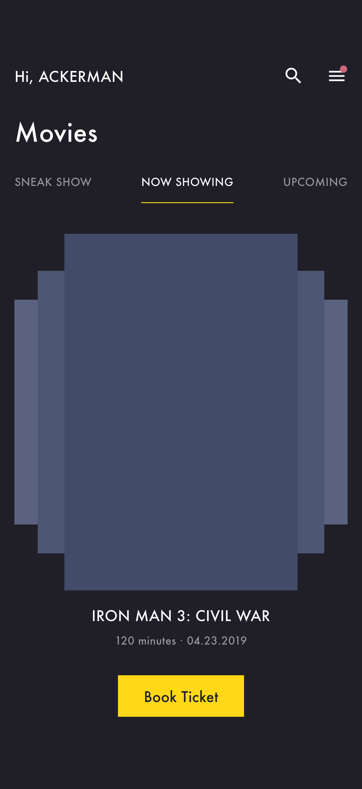
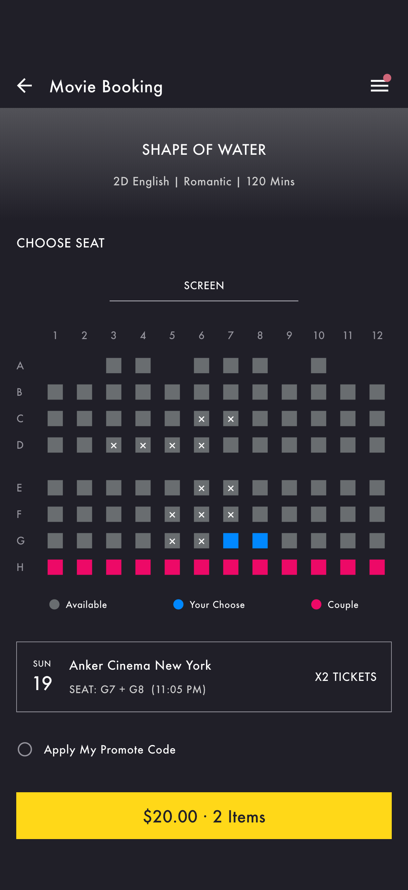
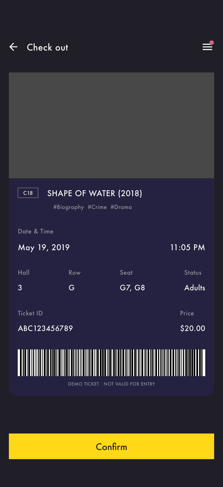
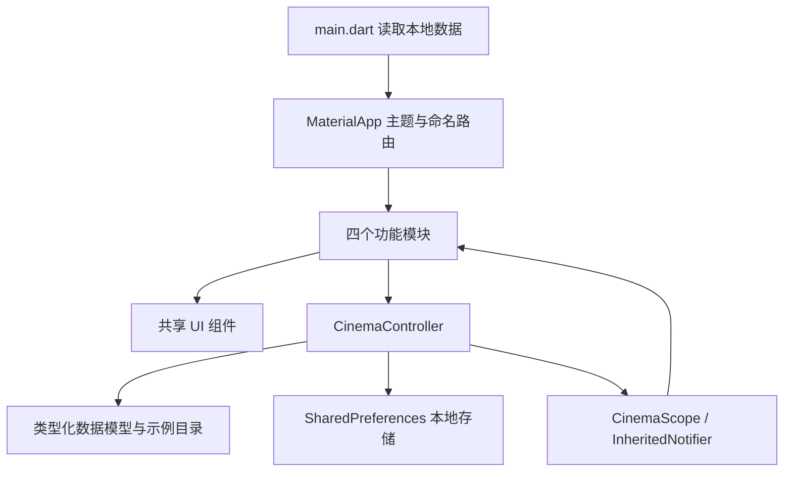
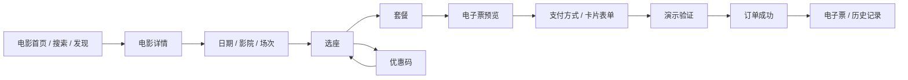

# Anker Cinema 项目结构与架构说明

## 1. 项目目标与交付范围

把 Pixso 当前「No Image」页面的 01–40 号参考稿落地为 Flutter 应用。应用采用原稿的深灰背景、黄色主按钮、Futura 字体、蓝色选中座位与粉色情侣座位，并将静态页面连接为可操作的影院购票流程。

本次交付包括：Flutter 源码，iOS / Android / Web 工程，40 个页面入口，40 张应用页面截图，5 张长页面补充截图，40 张 Pixso 原稿导出图，以及测试与架构说明。页面编号与原稿节点逐一对应，见 [页面截图索引](SCREENSHOTS.md)。

页面排版适配设备安全区与滚动空间，使用原生可交互控件；不是把整张设计截图铺在界面上。原稿中重复的电影卡片、按钮、导航、资料行与订单信息使用共享组件实现。

## 2. 主要界面

下面展示电影首页、详情、选座、电子票、结算与支付成功六个界面，体现“选电影 → 选座 → 确认订单 → 支付 → 获得电子票”的主要内容。


| 电影首页 | 选座 | 电子票 |
| --- | --- | --- |
|  |  |  |

选座支持选择与取消、已占座禁用、空选禁用下一步；套餐支持 0–9 份数量调整；优惠只作用于电影票。进入支付与电子票时，电影、影院、日期、场次、座位和总价来自同一份订单状态。

## 3. 目录结构

```text
AnkerCinema/
├── lib/
│   ├── main.dart                    # 初始化、读取本地数据、选择首屏
│   ├── app.dart                     # MaterialApp、主题、命名路由
│   ├── core/
│   │   ├── screens.dart              # 40 个页面的编号、标题、路由
│   │   ├── theme.dart                # 颜色、字体与控件主题
│   │   ├── models.dart               # Movie、SnackCombo、Booking、MovieReview
│   │   └── cinema_controller.dart    # 业务状态、金额计算、本地读写
│   ├── shared/
│   │   └── widgets.dart              # 页面壳、按钮、海报、电影卡片等
│   └── features/
│       ├── screen_view.dart          # 页面到功能模块的分发
│       ├── auth_screens.dart         # 欢迎、登录、注册、引导
│       ├── browse_screens.dart       # 电影、影人、影评、影院、地图、预览
│       ├── booking_screens.dart      # 场次、选座、套餐、电子票、结算、验证
│       └── account_screens.dart      # 菜单、账户、历史、会员、设置、相机演示
├── assets/
│   ├── app_icon.svg                  # 应用图标源文件
│   ├── fonts/                        # 本地字体
│   └── images/                       # 原稿插画与地图
├── test/
│   ├── cinema_controller_test.dart   # 金额、订单、持久化等逻辑测试
│   └── screens_test.dart             # 全页面布局与登录校验
├── integration_test/app_test.dart    # iOS 购票流程与页面截图
├── test_driver/integration_test.dart # 将模拟器截图写入项目目录
├── scripts/build_gallery.py          # 生成截图总览与索引
├── docs/
│   ├── PROJECT_ARCHITECTURE.md
│   ├── SCREENSHOTS.md
│   ├── TESTING.md
│   ├── design/                       # 40 张 Pixso 原稿与节点记录
│   └── screenshots/                  # 应用截图、补充截图与总览
├── ios/  android/  web/              # 平台工程
├── pubspec.yaml                     # 依赖与资源声明
└── README.md                         # 快速开始
```

## 4. 架构与数据流

采用“功能页面 + 共享组件 + 单一状态控制器”的轻量架构。当前数据规模不需要再增加多层空接口、代码生成或路由/状态管理框架。



- **展示层**：页面负责布局、输入校验和交互反馈；状态变化触发页面更新。
- **状态层**：`CinemaController extends ChangeNotifier`，统一管理当前电影、影院、日期、场次、座位、套餐、优惠、收藏和订单。
- **共享状态注入**：`CinemaScope` 使用 Flutter 内置 `InheritedNotifier`，页面按需读取。
- **数据层**：`Catalog` 提供只读示例内容；`Booking` 用 JSON 序列化存储。当前本地读写直接封装在控制器内，尚未引入独立 repository。
- **路由层**：`AppScreen` 枚举提供页面名、标题和编号，`ScreenView` 分发到对应模块。路由示例为 `/movies`、`/seats`、`/paymentSuccess`。

## 5. 核心业务规则

### 5.1 购票流程



选择新的电影会重置座位、套餐、优惠和当前出票状态。已生成的订单保留独立快照，不随之后的选座与价格变化改变。

### 5.2 金额计算

全部金额使用整数“分”，界面显示时再格式化为美元，避免浮点累积误差。

```text
电影票金额 = 座位数 × 1000 分
套餐金额   = Σ（套餐单价 × 数量）
优惠金额   = 有效 ANKER30 ? round(电影票金额 × 30%) : 0
订单金额   = 电影票金额 + 套餐金额 - 优惠金额
```

例如：G7 + G8 两张票为 `$20.00`，应用优惠后为 `$14.00`，再加一份 `$8.00` Single Combo，最终为 `$22.00`。优惠码重复应用不会重复折扣。

### 5.3 状态与校验

- 座位范围为 A–H、1–12；无座位位置和已占座均不可选。未选择座位不能继续结算。
- 套餐数量限制在 0–9。
- 登录校验邮箱格式和至少 6 位密码；注册增加昵称、手机与生日输入。此校验只用于本地演示。
- 其他卡片表单限制为演示卡号，检查有效期与 CVV 格式；卡片信息只存在页面内存中。
- 验证码为 `5012`；指纹图标是演示确认入口，未调用生物识别 SDK。
- `completeBooking()` 复用当前已生成订单，防止连续点击重复出票。
- 历史清空需要在应用内确认；收藏、资料与通知开关会写入本地存储。

## 6. 持久化范围

| 数据 | 本地键 | 生命周期 |
| --- | --- | --- |
| 昵称 / 邮箱 | `username` / `email` | 重启保留 |
| 演示登录状态 | `signedIn` | 重启保留，退出登录后清除标记 |
| 通知开关 | `notifications` | 重启保留 |
| 收藏电影 ID | `favorites` | 重启保留 |
| 订单快照 JSON | `bookings` | 重启保留，可从历史页清空 |
| 座位、套餐、优惠与当前草稿 | 内存 | 新电影或进程重启后重置 |
| 密码、卡号、CVV、验证码 | 不保存 | 离开输入页后销毁控制器 |
| 影评及点赞 | 内存 | 进程重启后重置 |

`SharedPreferences` 适合此演示中的少量本地数据。真实账户令牌应使用安全存储；真实订单、库存和支付结果应以后端为准。

## 7. 设计来源与适配

原稿页名为 **No Image**，电影海报、头像等采用灰色占位；保留此设定，没有添加与参考无关的海报。空历史插画、爆米花、会员装饰与静态地图直接导出自 Pixso，运行时不依赖临时 localhost URL。

读取设计时调用了 Pixso Flutter 设计转代码入口以提取布局与样式。该导出包含大量逐节点绝对定位、重复帮助类和无法下载的临时图片链接；最终实现已将它们替换为 Flutter 布局与共享组件，并删除临时导出源码。`docs/design/` 保留原稿截图与节点信息，便于核对。

主色参考值：背景 `#201F28`、主按钮 `#FFD818`、卡片 `#19162B`、选中座位 `#0088FF`、情侣座位 `#ED0967`。原稿字体主要为 Futura Book / Futura；当前本地开发版本使用本机 Futura Medium 与 Condensed Medium，字重与原稿 Book 存在差异。

字体资源来自当前 macOS 的 `/System/Library/Fonts/Supplemental/Futura.ttc`，供本机参考开发；正式分发前需替换为已获得应用嵌入授权的字体资源。应用图标为本项目绘制的黄色电影票与 A 字形，源文件为 `assets/app_icon.svg`。

对原稿作了运行所需的适配：

- 使用设备真实安全区；底部主操作保持可见，长内容可滚动。
- 对两种手机尺寸验证布局，验证码页在短屏上支持滚动。
- 重复示例卡片改为可区分的示例电影、三座影院与真实状态驱动的列表。
- 更正少量英文拼写，价格、座位数与订单内容从状态读取。
- 视频页采用手机竖屏可操作的预览控制；不含实际视频素材。
- 菜单补充发现、历史和个人资料入口，使所有功能可从应用中到达。

## 8. 依赖与精简

运行依赖只有 Flutter SDK、`shared_preferences` 和 `cupertino_icons`；后者补齐 Flutter 自适应控件需要的图标字体。没有额外引入状态管理、网络、路由或代码生成依赖。

共享 `CinemaPage`、`ActionButton`、`Poster`、`MovieTile`、`MovieStrip`、`Rating`、`MenuRow`、`SearchBox` 等组件；40 个页面状态复用四个功能模块。一次性的转码源码、默认计数器示例和无用 IDE 配置已清理，未将参考截图打包进应用资源。

## 9. 已实现与后续接入点

| 模块 | 当前实现 | 真实业务接入位置 |
| --- | --- | --- |
| 登录 / 注册 | 本地格式校验与账户状态 | 在控制器外增加 AuthRepository，替换演示登录 |
| 电影 / 影院 / 场次 | 类型化静态目录 | 将 `Catalog` 换为 API 数据来源 |
| 选座 | 已占座、选择切换、价格联动 | 后端座位锁定、超时释放与库存校验 |
| 优惠 / 套餐 | 本地规则与数量计算 | 后端报价与优惠校验 |
| 支付 / SMS / 指纹 | 演示确认，无扣款 | 支付 SDK、短信 API、生物识别与服务端支付回调 |
| 电子票 | 本地订单快照、展示性条码 | 后端票号、可核验二维码与入场状态 |
| 地图 | 原稿静态地图、影院标记、地址弹层 | 地图 SDK、定位与系统导航 |
| 视频 / 相机 | 交互预览与占位 | 播放器、视频 URL、相机权限与照片上传 |
| 会员 / 通知 | 原稿示例数据与偏好开关 | 会员积分服务、系统通知权限与推送服务 |

完整验证结果、截图再生成步骤与平台验证范围见 [TESTING.md](TESTING.md)。
